

# The Vervada

[![Discord][img-discord]][url-discord]
[![GitHub][img-github]][url-github]  
[![Modrinth][img-modrinth]][url-modrinth]

The Vervada brings a medieval golden age feeling to your kingdoms and villages. Made for builders, The Vervada combines variants and simple, yet detailed 3d models to add realism, more life and more depth to your creations while keeping the charm of Minecraft's textures.

Download it on Modrinth [![Latest][img-latest]][url-latest]

## Noteworthy features

- Randomized blocks
  - Randomized flower and flowers pots
  - Fully randomized bookshelves
- 3D vegetables and crops, also available as a [separate ressource pack.](https://modrinth.com/resourcepack/3d-plants)
  - Bushy leaves
  - 3D crops & flowers
- Custom models
  - Models for all doors and trapdoors
  - Realistic rails
- Revamped GUI
  - Sleek Hotbar & Icons
  - Themed GUI
- New blocks using double slabs also available as a [separate ressource pack.](https://modrinth.com/resourcepack/vervadas-double-slabs)

### Specials features

- 3D models / variants for most of entities
- connected textures
- customs barrel textures (rename a barrel Barrel of wheat / gold / iron / copper / fish / coal)

Use Fabulously Optimized to access those feature, get it here : [download.fo](download.fo).

### Gallery

More images on [Modrinth](https://modrinth.com/resourcepack/the-vervada/gallery).

## Specials thanks & credits

- Lead Artist : Valdr687
- With help from :
  - MicrowaveIsMe : 3D Models
  - [\_victor.blanc_](https://www.instagram.com/_victor.blanc_/) : Custom paintings

## Changelog

Moved to [changelogs.md](./changelogs.md).

## License

This work is licensed under a Creative Commons Attribution-NonCommercial-NoDerivatives 4.0 International License.  
Paintings belong to public domain, but this may vary depending on the region/artist.

___

## Painting Collection

|Vanilla Name|Title|Artist|Image|
|-:|-:|-:|-:|
|Aztec|_M. DEUTSCH'S AIRSHIP "LA VILLE DE PARIS"_|Raphael Tuck & sons||
|Burning skull|_La Falaise d’Étretat après l'orage_|Gustave Courbet|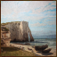|
|Bust|_Calle Martinez Anido_|Daniel Belin|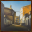|
|Courbet|_Jardin_|Claude Monet|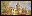|
|Creebet|_Le Pont aux Anglais_|Robert Antoine Pinchon|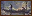|
|Donkey Kong|_Des Glaneuses_|Jean-François Millet|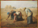|
|Fighters|_Battle of the combined Venetian and Dutch fleets against the Turks in the Bay of Foja_|Abraham Beerstratenm|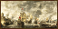|
|Graham|_American Gothic_|Grant DeVolson Wood||
|Pigscene|_Impression soleil levant_|Claude Monet|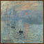|
|Plant|_The Money Changer and His Wife ( detail )_|Quentin Matsys|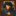|
|Pointer|_Montagne Sainte Victoire_|Paul Cézanne|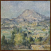|
|Pool|_La torre de Hercules_|Picasso|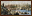|
|Sea|_Vanité_|Philippe de Champaigne||
|Skeleton|_Entree du port de La Rochelle_|Paul Signac|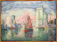|
|Skull and roses|_IKeelmen Heaving in Coals by Moonlight_|Joseph Mallord William Turner|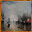|
|Stage|_Boats at Harbor Dock_|Willam Sherman||
|Sunset|_Pirates' Haunt_|Montague Dawson|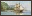|
|Void|_White Water Lilies_|Claude Monet|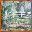|
|Wanderer|_The scream_|Edvard Munch|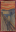|
|Wasteland|_Salvator Mundi_|Leonardo da Vinci|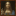|
|Wither|_Le seul oiseau qui vole au dessus des nuages_|André Devambez|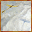|
|Backyard|_Une Rue à Nice_|Rémy Cogghe|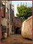|
|Baroque|_Le Port de Marseille_|Albert Marquet| 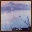 |
|Bouquet|_Le Chenal de Gravelines, soir_|Georges Seurat||
|Cavebird|_Fukuroi, Open-Air Teahouse_|Utagawa Hiroshige|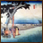|
|Changing|_Album of Insects and Other Creatures: Winter_|Mashiyama Sessai|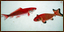|
|Cotan|_Coucher de soleil à Akashi_|Ito Shinsui| 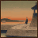 |
|Dennis|_La Grand'place de Roubaix sous la neige_|Ferdinand Schmidt|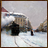|
|Endboss|_Kameyama, Clear Weather after Snow_|Utagawa Hiroshige|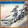|
|Fern|_Soleil couchant, temps brumeux, Pourville_|Claude Monet||
|Finding|_Station de bateaux à vapeur en Norvège_|Frithjof Smith-Hald||
| Humble | _New name_ | Artist |  |
|Lowmist|_Port-Marly, gelée blanche_|Alfred Sisley||
|Meditative|_Crâne et fémur humain dans une niche_|Bartholomaeus Bruyn the Elder|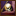|
|Orb|_Vétheuil le matin_|Claude Monet|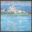|
|Owlemons|_Retour des bateaux à Yabase en fin de journée_|Ito Shinsui| 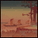 |
|Passage|_Yoshida, Toyokawabashi Bridge_|Utagawa Hiroshige|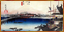|
|Pond|_Venise_|Rémy Cogghe|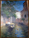|
|Prairie ride|_Birds and Flowers of the Four Seasons ( detail )_|Okamoto Shūki|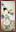|
|Sunflowers|_La Nuit étoilée_|Vincent van Gogh| 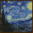 |
|Tides|_Le Quai au bois à Rouen_|Albert Lebourg|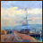|
|Unpacked|_Le Port de Camaret par ciel d'orage_|Eugène Boudin||

<!-- URLs -->

[img-discord]: <https://img.shields.io/badge/Discord-5865F2?style=for-the-badge&logo=discord&logoColor=white>
[img-github]: <https://img.shields.io/badge/GitHub-100000?style=for-the-badge&logo=github&logoColor=white>
[img-modrinth]: <https://img.shields.io/modrinth/dt/4Dg1DEy1?style=for-the-badge>
[img-latest]: <https://img.shields.io/modrinth/v/4Dg1DEy1?style=for-the-badge&logo=Modrinth>

[url-github]: <https://github.com/Valdr687/vervada>
[url-discord]: <https://discord.com/invite/rKgAg8X>
[url-modrinth]: <https://modrinth.com/resourcepack/the-vervada>
[url-latest]: <https://modrinth.com/resourcepack/the-vervada/versions>
